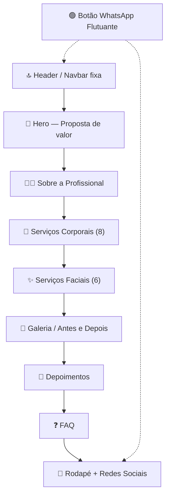

# 📋 Planejamento — Landing Page Camila Mirella Esteticista

> [!NOTE]
> Documento gerado após entrevista completa (grill-me). Nenhum código será produzido sem autorização explícita.

---

## 1. Visão Geral do Projeto

| Item | Decisão |
|---|---|
| **Profissional** | Camila Mirella — Esteticista autônoma |
| **Localização** | Taubaté – SP |
| **Público-alvo** | Mulheres de todas as faixas etárias |
| **Bio** | 🩺 Esteticista de alta performance & Graduanda em Biomedicina · Especialista em Redução de Medidas e Lipedema |
| **Tipo de página** | Landing page única (single-page) com navegação por âncoras |
| **Idioma** | Português (Brasil) |
| **CTA principal** | WhatsApp (botão flutuante + CTAs nas seções) |
| **Redes sociais** | Instagram (com estrutura extensível para futuras redes) |

---

## 2. Stack Tecnológica

| Item | Escolha | Motivo |
|---|---|---|
| **Bundler** | Vite (vanilla JS) | Leve, rápido, hot reload, build otimizado |
| **Linguagens** | HTML + CSS + JavaScript | Sem framework pesado, máxima performance |
| **Estilo** | CSS puro (vanilla) | Controle total, sem dependência de lib |
| **Animações** | CSS animations + Intersection Observer API | Animações de scroll reveal, fade-in, slide-up sem libs externas |
| **Abordagem** | Mobile-first responsivo | Excelente em mobile, bom em desktop |

---

## 3. Estrutura das Seções (ordem na página)

### 3.1. Header / Navbar
- Logo estilizada (nome "Camila Mirella" com tipografia premium — versão provisória)
- Menu com links âncora: Sobre · Serviços · Galeria · Depoimentos · FAQ · Contato
- Efeito de fixar no topo ao rolar (sticky), com fundo translúcido/glassmorphism suave
- Menu hambúrguer em mobile

### 3.2. Hero
- Frase principal: proposta de valor clara (ex: *"Realce sua beleza natural com cuidados especializados"*)
- Sub-headline com especialidade: *"Especialista em Redução de Medidas e Lipedema · Taubaté - SP"*
- Botão CTA: "Agende seu horário" → WhatsApp
- Imagem ilustrativa de fundo ou lateral
- Animação de surgimento suave (fade-in + slide-up)

### 3.3. Sobre a Profissional
- Foto/imagem ilustrativa da profissional
- Bio: Esteticista de alta performance, Graduanda em Biomedicina, Especialista em Redução de Medidas e Lipedema
- Espaço preparado para adicionar certificados futuramente
- Tom acolhedor e profissional

### 3.4. Serviços — Corporais (primeiro) + Faciais (segundo)
- **Duas categorias com subtítulo visual separando cada grupo**
- Cada serviço: título + imagem ilustrativa + descrição resumida
- Botão "Saiba mais" → abre **modal/pop-up** com a descrição completa do serviço
- Dentro do modal: botão CTA WhatsApp com mensagem pré-preenchida dinâmica:
  - *"Olá, gostaria de saber mais sobre [Nome do Serviço]!"*
- Layout em grid responsivo (2-3 colunas em desktop, 1 coluna em mobile)
- Animação de scroll reveal nos cards

#### Serviços Corporais (8):
1. Corrente Russa
2. Lipocavitação
3. Massagem Modeladora
4. Drenagem Linfática
5. Manta Térmica
6. Cintura Slim®️
7. Projeto Corpo Livre®️
8. Massagem Relaxante

#### Serviços Faciais (6):
1. Limpeza de Pele
2. Peeling Diamante
3. Hidratação Facial
4. Microagulhamento
5. Jato de Plasma

> [!NOTE]
> Total confirmado: **13 serviços** (8 corporais + 5 faciais).

### 3.5. Galeria / Antes e Depois
- Grid de imagens (usando imagem placeholder única, variando dimensões conforme combinado)
- Possibilidade de lightbox ao clicar para ampliar
- Animação de fade ao rolar

### 3.6. Depoimentos
- Cards com nome (fictício por enquanto), depoimento e avaliação (estrelas)
- Layout carousel/slider horizontal em mobile
- Preparado para substituir por depoimentos reais futuramente

### 3.7. FAQ
- Accordion/sanfona com perguntas e respostas expansíveis
- Perguntas sugeridas (a validar):
  - "Como funciona o agendamento?"
  - "Qual a duração das sessões?"
  - "Preciso de quantas sessões para ver resultado?"
  - "Os procedimentos são seguros?"
  - "Atende convênio?"

### 3.8. Rodapé (Footer)
- Logo + nome
- Cidade: Taubaté – SP
- Link Instagram (estrutura pronta para mais redes)
- Copyright
- Link WhatsApp

### 3.9. Botão WhatsApp Flutuante
- Fixo no canto inferior direito
- Ícone do WhatsApp com animação de pulso sutil
- Mensagem genérica: *"Olá, gostaria de saber mais sobre os serviços!"*
- Visível em todas as seções

---

## 4. Direção Visual (design-craft)

> Baseada na escolha **"Suave e acolhedor"** — inspiração spa/bem-estar.

### 4.1. Paleta de Cores (HSL)

| Papel | Cor | HSL | Hex aprox. |
|---|---|---|---|
| **Primária** | Rosé suave | `hsl(350, 35%, 72%)` | `#D4A0A7` |
| **Primária escura** | Rosé profundo | `hsl(350, 30%, 45%)` | `#955A62` |
| **Secundária** | Nude/bege quente | `hsl(30, 30%, 88%)` | `#E8DDD4` |
| **Fundo principal** | Branco quente | `hsl(30, 20%, 97%)` | `#FAF8F6` |
| **Fundo cards** | Branco puro | `hsl(0, 0%, 100%)` | `#FFFFFF` |
| **Texto principal** | Marrom escuro | `hsl(20, 15%, 22%)` | `#403530` |
| **Texto secundário** | Marrom médio | `hsl(20, 10%, 45%)` | `#7A706A` |
| **Accent/CTA** | Verde WhatsApp | `hsl(142, 70%, 40%)` | `#25D366` (só no botão WA) |

### 4.2. Tipografia

| Uso | Fonte | Peso | Tamanho base |
|---|---|---|---|
| **Títulos** | **Playfair Display** (Google Fonts) | 500–600 | 28–40px |
| **Corpo/UI** | **Inter** (Google Fonts) | 400 (regular) | 16px |
| **Botões/CTA** | Inter | 500 (medium) | 14–16px |

- Apenas **3 tamanhos de fonte** efetivos (heading, body, small) — regra de contenção design-craft
- Line-height: body ~1.5, headings ~1.15
- Largura máxima de texto: 65ch

### 4.3. Espaçamento
- Base: **8px**
- Escala: 4 / 8 / 12 / 16 / 24 / 32 / 48 / 64 / 96
- Mais espaço entre seções do que dentro delas

### 4.4. Sombras (escala de 3 níveis)
- **Leve** (cards): `0 1px 3px rgba(0,0,0,0.06)`
- **Média** (cards hover/modal): `0 4px 12px rgba(0,0,0,0.08)`
- **Alta** (modal overlay): `0 12px 32px rgba(0,0,0,0.12)`

### 4.5. Personalidade Visual
- **Cantos arredondados suaves** (8–12px nos cards, 24px nos botões)
- **Bordas mínimas** — separação por espaço, não por linhas
- **Sem gradientes agressivos** — tons suaves e transições sutis
- **Uma imagem placeholder** reutilizada em diferentes dimensões (conforme economia de assets combinada)
- **Micro-animações**: fade-in ao scroll, scale sutil no hover dos cards, transição suave do menu

### 4.6. Anti-Slop Checklist (design-craft)
- ❌ Sem gradientes roxos/neon
- ❌ Sem badges/pills decorativos
- ❌ Sem ícones em todas as linhas
- ❌ Sem glows ou sombras coloridas
- ❌ Sem stat widgets decorativos
- ✅ Contenção: poucos tamanhos de fonte, pesos regulares, hierarquia por cor e peso
- ✅ Personalidade concentrada em um elemento: a tipografia serif nos títulos

---

## 5. Animações e Interações

| Elemento | Animação | Técnica |
|---|---|---|
| Carregamento da hero | Fade-in + slide-up | CSS animation |
| Cards ao rolar | Scroll reveal (fade-in + translateY) | Intersection Observer |
| Hover nos cards de serviço | Scale sutil (1.02) + sombra média | CSS transition |
| Modal de serviço | Fade-in + scale do centro | CSS animation |
| Botão WhatsApp flutuante | Pulso suave periódico | CSS keyframes |
| Menu mobile (hambúrguer) | Slide-in lateral | CSS transition |
| FAQ accordion | Expand/collapse suave | CSS max-height transition |
| Navbar ao rolar | Background translúcido (glassmorphism leve) | Scroll event + CSS |

---

## 6. SEO & Performance

- Metatags: title, description, Open Graph (para compartilhamento no WhatsApp/Instagram)
- Heading hierarchy: um único `<h1>` no hero
- HTML semântico (`<header>`, `<main>`, `<section>`, `<footer>`, `<nav>`)
- Lazy loading em imagens
- Fonte otimizada via Google Fonts `display=swap`
- Build otimizado pelo Vite (minificação, tree-shaking)

---

## 7. Economia de Assets (skillpper-saver)

| Decisão | Impacto |
|---|---|
| Uma única imagem placeholder para todos os campos | Menos requests, menos peso |
| CSS puro sem libs externas de animação | Zero dependência extra |
| Intersection Observer nativo (sem AOS/GSAP) | Sem JS pesado |
| Vite vanilla (sem React/Vue) | Bundle mínimo |
| Conteúdo dos serviços já coletado na entrevista | Sem re-trabalho de pesquisa |

---

## 8. Decisões Pendentes ⚠️

| # | Decisão | Status |
|---|---|---|
| 1 | ~~Confirmar se são 13 ou 14 serviços~~ — **13 confirmados** (8 corporais + 5 faciais) | ✅ Resolvido |
| 2 | **Texto exato do hero** — headline e sub-headline final | ❓ Aguardando |
| 3 | ~~Perguntas do FAQ~~ — **aprovadas**, usuário ajusta manualmente depois se necessário | ✅ Resolvido |
| 4 | ~~Número de WhatsApp~~ — **12988642559** | ✅ Resolvido |
| 5 | ~~Link do Instagram~~ — **https://www.instagram.com/camilaestetica.br/** | ✅ Resolvido |
| 6 | **Depoimentos reais** — substituir os fictícios quando disponíveis | 📅 Futuro |
| 7 | **Logo definitiva** — substituir a versão provisória | 📅 Futuro |
| 8 | **Certificados adicionais** — quando tiver acesso | 📅 Futuro |
| 9 | **Fotos reais** — substituir a imagem placeholder | 📅 Futuro |
| 10 | **Hospedagem** — onde a página será publicada | ❓ Aguardando |

---

## 9. Próximas Etapas

1. ✅ ~~Entrevista grill-me~~ — concluída
2. ✅ ~~Planejamento consolidado~~ — este documento
3. ⏳ **Resolver decisões pendentes** (itens 1–5 da tabela acima)
4. ⏳ **Gerar mockup visual** (imagem conceitual da hero ou da página inteira, se desejado)
5. ⏳ **Aprovação para iniciar implementação** — aguardando autorização explícita
6. ⏳ **Desenvolvimento** — inicializar Vite, criar estrutura, implementar seções
7. ⏳ **Revisão e polimento** — testes em mobile, ajustes finos, animações
8. ⏳ **Deploy** — publicação na hospedagem escolhida

---

> [!TIP]
> Este planejamento serve como "fonte da verdade" para todo o desenvolvimento. Qualquer mudança de escopo deve ser registrada aqui antes de alterar código.
